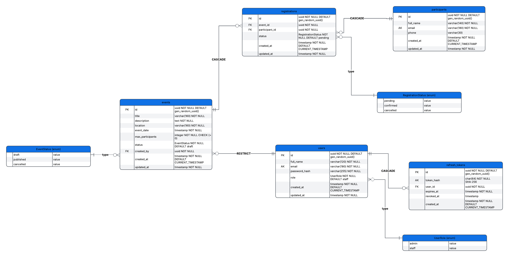

# EventHub

Application web de gestion d'événements et d'inscriptions, réalisée avec le
stack **PERN** (PostgreSQL, Express, React, Node.js).

L'équipe d'organisation (rôles `admin` et `staff`) crée et publie des
événements, gère les participants et suit les inscriptions. Les règles de
gestion sont appliquées côté serveur, avec une validation par la base de
données pour celles quitouchent à l'intégrité des données.

---

## Sommaire

- [Stack](#stack)
- [Installation](#installation)
- [Variables d'environnement](#variables-denvironnement)
- [Commandes](#commandes)
- [Comptes de démonstration](#comptes-de-démonstration)
- [Structure du projet](#structure-du-projet)
- [Modèle de données](#modèle-de-données)
- [Rôles et autorisations](#rôles-et-autorisations)
- [Règles de gestion](#règles-de-gestion)
- [API](#api)
- [Tests](#tests)
- [Documentation](#documentation)
- [Notes de conception](#notes-de-conception)

---

## Stack

| Couche | Choix | Détail |
|---|---|---|
| Base de données | PostgreSQL 16 | Schéma créé par migration Prisma, contraintes SQL explicites |
| ORM | Prisma 7 | Client généré dans `server/src/generated/prisma` |
| Backend | Node.js 22, Express 5, TypeScript | API REST sous `/api` |
| Authentification | JWT (bcrypt) | Access token + refresh token rotatif en cookie `HttpOnly` |
| Validation | Zod 4 | Un schéma par module, erreurs renvoyées en 400 |
| Tests | Jest 30, Supertest | 43 tests sur une base dédiée |
| Frontend | React 19, Vite 8, React Router 7, Axios, Tailwind CSS 4 | Interface en français |
| Conteneurisation | Docker Compose | PostgreSQL, API, front servis par nginx |

---

## Installation

### Avec Docker — toute l'application

Une seule commande démarre PostgreSQL, l'API et l'interface.

```bash
docker compose up --build
```

| Service | URL |
|---|---|
| Interface (nginx, qui relaie `/api` vers l'API) | http://localhost:8080 |
| API | http://localhost:4000/api |
| Documentation OpenAPI | http://localhost:4000/api/docs |
| PostgreSQL | `localhost:5432` |

Un service `migrate` applique les migrations avant le démarrage de l'API, qui
n'embarque que les dépendances de production.

Jeu de données de démonstration (aucune installation de Node requise) :

```bash
docker compose run --rm migrate npx prisma db seed
```

### En développement — rechargement à chaud

Cette variante ne lance que PostgreSQL en conteneur et exécute l'API et le front
sur la machine, avec rechargement automatique.

```bash
docker compose up -d db

cd server
npm install
cp .env.example .env      # puis renseigner les secrets JWT
npm run prisma:migrate    # applique les migrations
npm run db:seed           # jeu de données de démonstration
npm run dev               # http://localhost:4000/api

cd ../client
npm install
npm run dev               # http://localhost:5173
```

Vite proxifie `/api` vers `http://localhost:4000`. Le front et l'API sont donc
vues comme une origine unique par le navigateur : le cookie `HttpOnly` du refresh
token est envoyé sans configuration CORS.

> Si le port 5173 est déjà occupé, Vite choisit automatiquement le port suivant ;
> l'adresse est affichée dans la sortie de la commande.

---

## Variables d'environnement

Le fichier `server/.env` est lu au démarrage. Si une variable obligatoire est
absente ou invalide, le serveur s'arrête avec le détail des erreurs plutôt que
de démarrer dans un état incohérent.

| Variable | Obligatoire | Défaut | Rôle |
|---|---|---|---|
| `DATABASE_URL` | oui | — | Chaîne de connexion PostgreSQL |
| `JWT_ACCESS_SECRET` | oui | — | Clé de signature des access tokens (16 caractères minimum) |
| `PORT` | non | `4000` | Port d'écoute de l'API |
| `NODE_ENV` | non | `development` | `development`, `test` ou `production` |
| `ACCESS_TOKEN_TTL` | non | `30m` | Durée de vie de l'access token |
| `REFRESH_TOKEN_TTL_DAYS` | non | `7` | Durée de vie du refresh token |
| `REFRESH_COOKIE_NAME` | non | `eventhub_refresh` | Nom du cookie de session |

En production, `JWT_ACCESS_SECRET` doit être une valeur aléatoire forte. Le
cookie de session est marqué `Secure` automatiquement lorsque la requête arrive
en HTTPS, y compris derrière le proxy nginx, et reste utilisable en HTTP local.

---

## Commandes

### `server/`

| Commande | Effet |
|---|---|
| `npm run dev` | Serveur de développement avec rechargement à chaud |
| `npm run build` | Génère le client Prisma puis compile en TypeScript |
| `npm start` | Lance le code compilé depuis `dist/` |
| `npm run prisma:migrate` | Crée et applique une migration |
| `npm run prisma:deploy` | Applique les migrations existantes (production) |
| `npm run prisma:generate` | Régénère le client Prisma |
| `npm run db:seed` | Charge le jeu de démonstration |
| `npm run db:reset` | Réinitialise la base puis applique les migrations |
| `npm test` | Exécute la suite Jest |

### `client/`

| Commande | Effet |
|---|---|
| `npm run dev` | Serveur Vite avec rechargement à chaud |
| `npm run build` | Vérification des types puis build de production |
| `npm run preview` | Prévisualise le build de production |

---

## Comptes de démonstration

Créés par `npm run db:seed`.

| Rôle | Email | Mot de passe |
|---|---|---|
| `admin` | `admin@eventhub.ma` | `Admin@2026` |
| `staff` | `staff@eventhub.ma` | `Staff@2026` |

Ces identifiants servent uniquement au développement. Les mots de passe sont
hachés avec bcrypt (12 tours) et ne sont jamais renvoyés par l'API.

Le seed crée également 5 événements, 10 participants et 20 inscriptions réparties
sur les trois statuts.

---

## Structure du projet

```
.
├── client/                     Front React + Vite
│   ├── src/
│   │   ├── api/                Client Axios, intercepteur de refresh, types
│   │   ├── auth/               Contexte d'authentification
│   │   ├── components/         Layout, badges, pagination, primitives UI
│   │   └── pages/              Une page par écran
│   ├── Dockerfile
│   └── nginx.conf
├── server/                     API Express + TypeScript
│   ├── prisma/
│   │   ├── migrations/         SQL appliqué par Prisma Migrate
│   │   ├── schema.prisma       Source de vérité du modèle
│   │   └── seed.ts             Jeu de données de démonstration
│   ├── src/
│   │   ├── config/             Lecture et validation de l'environnement
│   │   ├── docs/               Montage de la documentation OpenAPI
│   │   ├── lib/                Client Prisma, erreurs, sécurité, helpers HTTP
│   │   ├── middleware/         Authentification, rôles, gestion d'erreurs
│   │   ├── modules/            Un dossier par domaine métier
│   │   ├── app.ts              Assemblage Express
│   │   └── server.ts           Point d'entrée et arrêt propre
│   ├── tests/                  Suite Jest + Supertest
│   ├── openapi.yaml            Spécification OpenAPI 3
│   └── Dockerfile
├── docs/
│   └── images/                 Diagramme entité-association
└── docker-compose.yml
```

Chaque dossier de `server/src/modules/` contient les mêmes trois fichiers :
`*.schema.ts` (schémas Zod), `*.service.ts` (logique métier et accès aux
données), `*.routes.ts` (routes et contrôle d'accès). Il n'y a pas de couche
« controller » : la validation et le service suffisent, un contrôleur
n'ajouterait qu'une indirection.

---

## Modèle de données



> Le diagramme se trouve dans `docs/images/erd.png`. Le schéma exécutable
> reste `server/prisma/schema.prisma` et le SQL appliqué est
> `server/prisma/migrations/20261013161923_init/migration.sql`.

Cinq tables :

- `users` — comptes de l'équipe (`admin`, `staff`)
- `events` — événements, avec `status` et `max_participants`
- `participants` — personnes inscrites, email unique
- `registrations` — table pivot N-N, avec son propre statut
- `refresh_tokens` — sessions actives, avec rotation et révocation

Le schéma exécutable est `server/prisma/schema.prisma` et le SQL appliqué est
`server/prisma/migrations/20261013161923_init/migration.sql`.

---

## Rôles et autorisations

| | `admin` | `staff` |
|---|---|---|
| Consulter les événements | oui | oui |
| Créer, modifier, publier un événement | oui | oui |
| Supprimer un événement | oui | non |
| Gérer les participants | oui | oui |
| Supprimer un participant | oui | non |
| Gérer les inscriptions | oui | oui |
| Gérer les comptes utilisateurs | oui | non |
| Consulter le tableau de bord | oui | oui |

Un compte ne peut ni se supprimer lui-même ni retirer son propre rôle `admin`.

---

## Règles de gestion

Les quatre règles imposées par l'énoncé sont vérifiées côté service, dans une
transaction, et non laissées au seul front.

**1. Un participant ne peut s'inscrire qu'à un événement publié.**
Refusé avec `400 EVENT_NOT_PUBLISHED`.

**2. Pas de double inscription sur un même événement.**
Refusé avec `409 ALREADY_REGISTERED`. La vérification applicative est doublée
par la contrainte `UNIQUE (event_id, participant_id)` : si un insert contourne
l'API, PostgreSQL refuse quand même, et l'erreur `P2002` est traduite en `409`.

**3. Le nombre d'inscriptions ne peut pas dépasser `maxParticipants`.**
Refusé avec `409 EVENT_FULL`. Le compte des places est fait dans une transaction
qui verrouille d'abord la ligne de l'événement :

```sql
SELECT id, status, max_participants
FROM events
WHERE id = $1::uuid
FOR UPDATE
```

Ce verrou est indispensable. Sans lui, deux inscriptions simultanées sur la
dernière place peuvent toutes deux lire un compteur inférieur à la capacité et
toutes deux aboutir. Un test de la suite lance trois inscriptions en parallèle
sur un événement de deux places et vérifie que deux seulement passent.

Seules les inscriptions dont le statut n'est pas `cancelled` occupent une place :
annuler une inscription libère donc de nouveau une place.

**4. Annuler un événement annule toutes ses inscriptions.**
Dans la même transaction que le changement de statut, un `updateMany` fait
passer en `cancelled` toutes les inscriptions actives de l'événement.

**Cycle de vie d'un événement**

```text
draft ──publish──> published ──cancel──> cancelled
  ^                                            │
  └────────────── restore ─────────────────────┘
```

Une transition non autorisée renvoie `400 INVALID_STATUS_TRANSITION`. Avant
republication, l'API vérifie que le nombre d'inscriptions actives n'excède pas
`maxParticipants` — ce qui peut arriver si la capacité a été réduite entre-temps.

---

## API

Base : `/api`. Toutes les réponses suivent la même enveloppe : `data` pour le
contenu, `meta` pour la pagination, `error` avec un `code` stable en cas
d'échec.

| Code | Signification |
|---|---|
| `400` | Données invalides ou règle de gestion qui refuse l'opération |
| `401` | Jeton absent, invalide ou expiré |
| `403` | Rôle insuffisant |
| `404` | Ressource ou route inexistante |
| `409` | Conflit métier : doublon, événement complet, email déjà utilisé |
| `500` | Erreur interne, le détail n'est jamais exposé |

| Méthode | Route | Rôle |
|---|---|---|
| `POST` | `/api/auth/login` | public |
| `POST` | `/api/auth/refresh` | public, cookie requis |
| `POST` | `/api/auth/logout` | public, cookie requis |
| `GET` | `/api/auth/me` | authentifié |
| `GET` | `/api/events?status=&date=&search=&page=&limit=` | authentifié |
| `POST` | `/api/events` | admin, staff |
| `GET` | `/api/events/:id` | authentifié |
| `PUT` | `/api/events/:id` | admin, staff |
| `PATCH` | `/api/events/:id/status` | admin, staff |
| `DELETE` | `/api/events/:id` | admin |
| `GET` | `/api/participants?search=&page=&limit=` | admin, staff |
| `POST` | `/api/participants` | admin, staff |
| `GET` | `/api/participants/:id` | admin, staff |
| `PUT` | `/api/participants/:id` | admin, staff |
| `DELETE` | `/api/participants/:id` | admin |
| `GET` | `/api/registrations?eventId=&participantId=&status=&page=&limit=` | admin, staff |
| `POST` | `/api/registrations` | admin, staff |
| `PATCH` | `/api/registrations/:id/status` | admin, staff |
| `GET` | `/api/users?role=&search=&page=&limit=` | admin |
| `POST` | `/api/users` | admin |
| `PUT` | `/api/users/:id` | admin |
| `DELETE` | `/api/users/:id` | admin |
| `GET` | `/api/dashboard` | admin, staff |
| `GET` | `/api/health` | public |

La spécification complète, avec schémas de requêtes et de réponses, est servie
sur **http://localhost:4000/api/docs**.

---

## Tests

```bash
cd server
npm test
```

43 tests répartis en trois suites. Ils s'exécutent sur la base `eventhub_test`,
créée automatiquement et remise à zéro avant chaque test : la base de
développement n'est jamais touchée.

| Suite | Couverture |
|---|---|
| `auth.test.ts` | Connexion, cookie `HttpOnly`, `/me`, jetons falsifiés, rôles, rotation du refresh token |
| `events.test.ts` | Création, filtres, pagination, validation, cycle de vie, participants, tableau de bord |
| `registrations.test.ts` | Les quatre règles de gestion, y compris la concurrence sur la capacité |

---

## Documentation

| Document | Contenu |
|---|---|
| `docs/images/erd.png` | Diagramme entité-association |
| `server/openapi.yaml` | Spécification OpenAPI 3, servie sur `/api/docs` |
| `server/prisma/migrations/` | DDL appliqué, commenté |

---

## Notes de conception

**Refresh token stocké, pas un JWT.** L'access token est un JWT de courte durée
porté par l'en-tête `Authorization`. Le refresh token est une valeur aléatoire
opaque dont seul le hash SHA-256 est enregistré, ce qui permet deux choses qu'un
refresh token JWT ne permet pas : la révocation immédiate à la déconnexion et la
rotation. À chaque rafraîchissement, l'ancien token est révoqué et un nouveau est
émis dans la même transaction. Un ancien token rejoué est donc refusé.

**Cookies plutôt que `localStorage`.** Stocker un jeton dans `localStorage` le
rend lisible par tout script injecté sur la page. Le cookie `HttpOnly` avec
`sameSite=lax` n'est pas accessible en JavaScript. Le proxy Vite en
développement et le proxy nginx en production servent les deux origines depuis
le même nom d'hôte, ce qui évite d'avoir à configurer CORS avec credentials.

**Validation par schéma Zod, parsing dans les handlers.** Chaque route expose
son schéma ; la validation est faite par un appel explicite en tête de handler.
L'erreur `ZodError` est traduite une seule fois, dans le middleware d'erreurs,
en `400` avec le détail par champ. Cela évite un middleware de validation
générique et un cast de type à chaque lecture.

**Erreurs métier typées.** Toutes les erreurs attendues sont des `AppError`,
porteuses d'un code HTTP et d'un code métier. Le middleware les traduit en
réponse ; les erreurs Prisma sont reconnues par leur code (`P2002`, `P2003`,
`P2025`) et traduites à leur tour. Un `console.error` ne reçoit que ce qui est
réellement inattendu, et le détail n'est renvoyé au client qu'en développement.

**Recherche par sous-chaîne.** `GET /api/participants?search=` fait un
`ILIKE '%terme%'`, qu'aucun index B-tree ne peut servir. Trois index GIN
trigrammes (`pg_trgm`) sont créés dans la migration pour couvrir la recherche sur
le nom, l'email et l'intitulé d'un événement.

**Contraintes hors ORM.** `schema.prisma` ne sait pas exprimer une contrainte
`CHECK` ni un index trigramme. Ces éléments sont ajoutés à la main dans le
fichier de migration, ce qui évite de dupliquer une partie du schéma dans une
migration SQL parallèle.